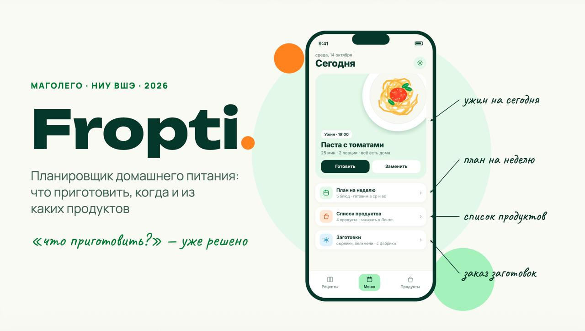

# Fropti · Shopping List API


Fropti помогает планировать домашнее питание: что приготовить, когда готовить и какие продукты купить. Shopping List API получает рецепты и формирует список покупок с учётом порций, единиц, повторяющихся ингредиентов и запасов дома.




Это материалы питча и макеты целевого продукта, не список готовых интеграций. Описание файлов и правила добавления новых слайдов есть в [docs/slides](docs/slides/README.md).

## Задача модуля

Сервис принимает один или несколько объектов `Recipe`, пересчитывает ингредиенты на нужное число порций, объединяет совпадающие продукты, приводит совместимые единицы, учитывает словарь синонимов и вычитает запасы. API возвращает отдельный контракт `ShoppingList`; общий `Recipe` не расширяется складскими или UI-полями.

| В репозитории | Следующий этап |
| --- | --- |
| FastAPI, CLI, Docker, CI и тесты публичных границ | Реализовать масштабирование, нормализацию и агрегацию |
| Внешняя зависимость на единый `fropti-core-contracts` | Описать и протестировать правила синонимов, единиц и остатков |
| Синтетические примеры, рубрика, шаблон PR | Подготовить приёмочный набор и результаты проверки |

## Быстрый старт

Нужны Git, Docker Compose и Python 3.10+.

```bash
git clone https://github.com/VictoriaPugach/shopping-list-aggregation-api.git
cd shopping-list-aggregation-api
make install
make test
make run
```

Открыть [Swagger UI](http://localhost:8001/docs). Docker-вариант: `docker compose up --build`. Файл `.env` понадобится только после появления настроек внешних поставщиков. Внешний пакет `fropti-core-contracts` устанавливается из репозитория Video → Recipe, поэтому все модули читают один и тот же `Recipe` 1.0.0.

## API и данные

`POST /aggregate` принимает JSON с массивом `recipes`. Целевой ответ содержит агрегированные позиции списка покупок; пока это точка расширения каркаса. Подробности есть в [API reference](docs/api_reference.md).

```json
{
  "recipes": [
    {
      "schema_version": "1.0.0",
      "title": "Омлет",
      "servings": 1,
      "ingredients": [{"name": "Яйца", "quantity": {"value": 2, "unit": "pcs"}}],
      "steps": [{"instruction": "Взбейте яйца."}],
      "source": {"type": "manual"}
    }
  ]
}
```

Общий контракт и правила подключения трёх модулей описаны в [docs/data_schema.md](docs/data_schema.md). Синтетический вход и ожидаемый формат результата находятся в [data](data/).

## Объём MVP

Обязательный результат: один API и CLI-сценарий, приём валидных `Recipe`, пересчёт порций, агрегация повторов, безопасные конверсии `g` ↔ `kg` и `ml` ↔ `l`, обработка неизвестного количества, словарь синонимов, вычитание запасов, тесты и воспроизводимый набор примеров.

Бонусы после MVP: категории магазина, цены, внешние каталоги, оптимизация маршрута, рекомендации и UI. Полный план находится в [src/TODO.md](src/TODO.md).

## Проверка и сдача

- `make test`: обязательная локальная проверка; CI запускает её на `push` и Pull Request.
- [docs/evaluation.md](docs/evaluation.md): рубрика, ответственность и измеримые критерии.
- [CONTRIBUTING.md](CONTRIBUTING.md): правила ревью Виктории Пугач и Любы Новохацкой.
- [PR template](.github/pull_request_template.md): команды проверки, JSON-примеры и демонстрационный ролик до четырёх минут.
- [SECURITY.md](SECURITY.md): как сообщать об уязвимостях; секреты и персональные данные в репозиторий не добавлять.

## Навигация

| Материал | Содержание |
| --- | --- |
| [Архитектура](docs/architecture.md) | Границы модулей и целевой pipeline |
| [Схема данных](docs/data_schema.md) | Общий `Recipe` и выходной формат ShoppingList |
| [API](docs/api_reference.md) | Эндпоинты и ошибки |
| [FAQ](docs/faq.md) | Практические вопросы реализации |
| [Примеры](data/README.md) | Синтетические входы и ожидаемый формат результата |

Лицензия кода: [MIT](LICENSE).
