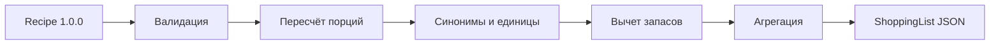

# Архитектура

Shopping List API работает как Python-микросервис с FastAPI. Мобильное приложение отправляет уже валидные `Recipe` по REST. Python не запускается на устройстве пользователя.

`Recipe` поставляет модуль Video → Recipe или ручной ввод. Этот сервис не меняет его поля. Его собственный результат содержит агрегированные позиции, а правила категорий магазина, цен и маршрутов находятся за пределами MVP.

## Границы MVP

В лимит 10–12 часов входят пересчёт порций, объединение повторов, конверсии `g` ↔ `kg` и `ml` ↔ `l`, словарь синонимов, вычет запасов, API/CLI и тесты. Нельзя автоматически переводить массу в объём без плотности или молча заменять неизвестное количество на ноль.
